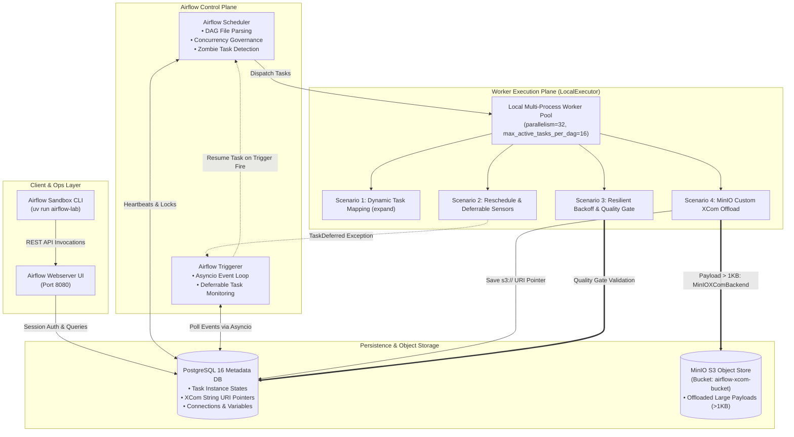

# Apache Airflow 2.10+ Production Sandbox

[](https://www.python.org/)
[](https://airflow.apache.org/)
[](https://www.postgresql.org/)
[](https://min.io/)
[](https://github.com/astral-sh/uv)
[](https://docs.docker.com/compose/)

A production-grade **Apache Airflow 2.10+** sandbox engineered to resolve key Lead Data Engineering assessment competencies: modern TaskFlow API patterns, dynamic task mapping, non-blocking reschedule sensors, Triggerer-based deferrable operators, exponential retry backoff, circuit-breaker quality gates, and zero-bloat S3/MinIO Custom XCom backends.

---

## 🎯 Targeted Assessment Gaps & Solutions

| Assessment Competency Gap | Production Solution Implemented | Location in Codebase |
| :--- | :--- | :--- |
| **1. Modern Operator & TaskFlow Details** | Seamless interoperability between `@task`, `@task.branch`, and classic operators (`BashOperator`, `PythonOperator`, `EmptyOperator`). Dynamic parallelization via `expand()` and `partial()`. | [`01_modern_operators_dynamic_mapping.py`](file:///C:/Users/salat/projects/airflow/dags/01_modern_operators_taskflow.py) |
| **2. Deployment & Scalability Evidence** | Full production cluster deployment (Webserver, Scheduler, Triggerer, Postgres, MinIO) with LocalExecutor concurrency tuning (`parallelism=32`, `max_active_tasks_per_dag=16`). | [`docker-compose.yml`](file:///C:/Users/salat/projects/airflow/docker-compose.yml), [`operational_runbook.md`](file:///C:/Users/salat/projects/airflow/docs/operational_runbook.md) |
| **3. Advanced Sensors & Slot Starvation** | Eliminating worker slot starvation using `mode="reschedule"`. True non-blocking asynchronous event waiting via the **Airflow Triggerer** daemon (`TimeDeltaSensorAsync`). | [`02_advanced_sensors_reschedule_deferrable.py`](file:///C:/Users/salat/projects/airflow/dags/02_advanced_sensors_reschedule_deferrable.py) |
| **4. Retries, Backoff & Resilience** | Exponential backoff retry policies (`retries=3`, `retry_delay=30s`, `retry_exponential_backoff=True`, `max_retry_delay=10m`), `on_failure_callback`, and downstream publish protection via Data Quality Gates. | [`03_retries_backoff_callbacks_gate.py`](file:///C:/Users/salat/projects/airflow/dags/03_retries_backoff_callbacks_gate.py), [`callbacks.py`](file:///C:/Users/salat/projects/airflow/src/airflow_sandbox/callbacks.py) |
| **5. Large Payloads & Custom XCom Backend** | Eliminating PostgreSQL DB & WAL bloat by intercepting payloads $>1\text{KB}$, offloading to MinIO S3, and saving lightweight `s3://` reference pointers in metadata tables. | [`custom_xcom_backend.py`](file:///C:/Users/salat/projects/airflow/plugins/custom_xcom_backend.py), [`04_custom_xcom_backend_minio.py`](file:///C:/Users/salat/projects/airflow/dags/04_custom_xcom_backend_s3.py) |

---

## 🏗️ Architecture & Component Topology



---

## 🚀 Quickstart Guide

### 1. Prerequisites
- **Python 3.13** and [uv](https://github.com/astral-sh/uv) installed.
- **Docker** & **Docker Compose v2** running.

### 2. Environment Setup
Clone the repository and synchronize virtual environment dependencies via `uv`:
```bash
git clone https://github.com/Salatich/airflow-lab.git
cd airflow-lab

# Synchronize virtualenv with pinned lockfile
uv sync
```

### 3. Start Infrastructure via Docker Compose
Launch PostgreSQL, MinIO, bucket initialization, Airflow DB migration, Webserver, Scheduler, and Triggerer:
```bash
docker compose up -d
```

### 4. Verify Cluster Health & Inspect Settings
Use the custom CLI to verify service availability and review tuning parameters:
```bash
# Display configuration and assessment matrix
uv run airflow-lab info

# Verify Docker container states, MinIO API, and Airflow REST health
uv run airflow-lab verify
```

Airflow Web UI is accessible at:
- **URL:** [http://localhost:8080](http://localhost:8080)
- **Username:** `airflow`
- **Password:** `airflow`

MinIO Web Console is accessible at:
- **URL:** [http://localhost:9001](http://localhost:9001)
- **Username:** `minioadmin`
- **Password:** `minioadmin`

---

## 🧪 Running Automated Tests

Run the complete pytest test suite covering DAG integrity, custom XCom serialization, and retry callbacks:
```bash
uv run pytest -v
```

---

## 🧩 Deep Dive: Core Scenarios Implemented

### Scenario 1: Modern Operators & Dynamic Task Mapping
[DAG: `01_modern_operators_dynamic_mapping`](file:///C:/Users/salat/projects/airflow/dags/01_modern_operators_taskflow.py)
- **TaskFlow & Classic Mix:** Combines `@task` and `@task.branch` decorators with `BashOperator`, `PythonOperator`, and `EmptyOperator`.
- **Dynamic Task Mapping:** Replaces rigid, static DAG definitions with dynamic runtime mapping via `.expand()`:
  ```python
  @task(task_id="process_partition", max_active_tis_per_dag=8)
  def process_partition(partition_meta: dict[str, Any]) -> dict[str, Any]: ...


  # Expands dynamically over runtime-discovered partitions
  mapped_results = process_partition.expand(partition_meta=discovered_partitions)
  ```
- **Map-Reduce Fan-In:** Collects all dynamically mapped task instance outputs into a downstream reducer `@task` without manual XCom key pulling.

---

### Scenario 2: Advanced Sensors & Worker Slot Starvation
[DAG: `02_advanced_sensors_reschedule_deferrable`](file:///C:/Users/salat/projects/airflow/dags/02_advanced_sensors_reschedule_deferrable.py)

#### Why `mode="poke"` Causes Cluster Deadlock:
In standard `mode="poke"`, the sensor retains an allocated worker slot and OS process for the entire duration of its execution, sleeping between checks. When 32 sensors run concurrently under `AIRFLOW__CORE__PARALLELISM=32`, **100% of cluster worker slots are occupied by sleeping sensors**, starving all ETL workloads.

```
mode="poke":       [ Worker Slot Occupied ]──(Sleep 60s)──[ Worker Slot Occupied ]──(Sleep 60s)──> [STARVATION]
mode="reschedule": [ Slot Used ] -> (Slot Relinquished) -> [ Slot Used ] -> (Slot Relinquished)──> [SAFE]
Triggerer Async:   [ TaskDeferred ] -> (Triggerer Asyncio Event Loop - ZERO Worker Slots)        ──> [OPTIMAL]
```

#### Production Patterns Demonstrated:
1. **`mode="reschedule"`:** Frees the worker slot between poke intervals, returning the task to the `UP_FOR_RESCHEDULE` state.
2. **Deferrable Operators via Triggerer (`TimeDeltaSensorAsync`):** Suspends the task and hands off event evaluation to the `airflow-triggerer` daemon. A single Triggerer process handles thousands of concurrent triggers using Python's `asyncio` event loop with zero worker CPU overhead.

---

### Scenario 3: Retries, Exponential Backoff, and Quality Gates
[DAG: `03_retries_backoff_callbacks_gate`](file:///C:/Users/salat/projects/airflow/dags/03_retries_backoff_callbacks_gate.py)
- **Exponential Backoff Formula:**
  $$\text{Delay}(n) = \min(\text{retry\_delay} \times 2^{n - 1},\, \text{max\_retry\_delay})$$
  Prevents thundering herd problems on downstream databases during transient outages.
- **Enterprise Callbacks:**
  - `on_failure_callback`: Extracts run context, try count, and log URLs for incident routing.
  - `on_retry_callback`: Logs transient backoff warnings.
  - `sla_miss_callback`: Detects and flags pipeline SLA breaches.
- **Circuit Breaker Data Quality Gate:** Validates row counts, null constraints, and anomalous values. Corrupted batches raise `AirflowFailException`, halting downstream execution before dirty data reaches production.

---

### Scenario 4: Transparent MinIO S3 Custom XCom Backend
[DAG: `04_custom_xcom_backend_minio`](file:///C:/Users/salat/projects/airflow/dags/04_custom_xcom_backend_s3.py) | [Plugin: `custom_xcom_backend.py`](file:///C:/Users/salat/projects/airflow/plugins/custom_xcom_backend.py)
- **Postgres Bloat Mitigation:** Standard Airflow stores XCom payloads as BYTEA directly in the PostgreSQL metadata DB. Serializing large DataFrames saturates write-ahead logs (WAL) and severely impacts scheduler performance.
- **MinIOXComBackend:** Automatically checks serialized payload byte length:
  - If $\le 1024\text{ bytes}$: Persists directly in PostgreSQL.
  - If $> 1024\text{ bytes}$: Uploads payload to MinIO (`s3://airflow-xcom-bucket/xcom/...`) and stores only a 64-byte URI string in PostgreSQL.
  - Downstream tasks consuming the XCom value deserialize the data transparently from S3.

---

## 📚 Technical Runbooks & Reference Documentation
- 📖 [System Architecture & Executor Tradeoff Matrix](docs/architecture.md)
- 🛠️ [Operational Runbook, Concurrency Formulas & Troubleshooting Guide](docs/operational_runbook.md)

---

## 👤 Author
**Salatich** ([@Salatich](https://github.com/Salatich))  
Lead Data Engineer Portfolio Project
