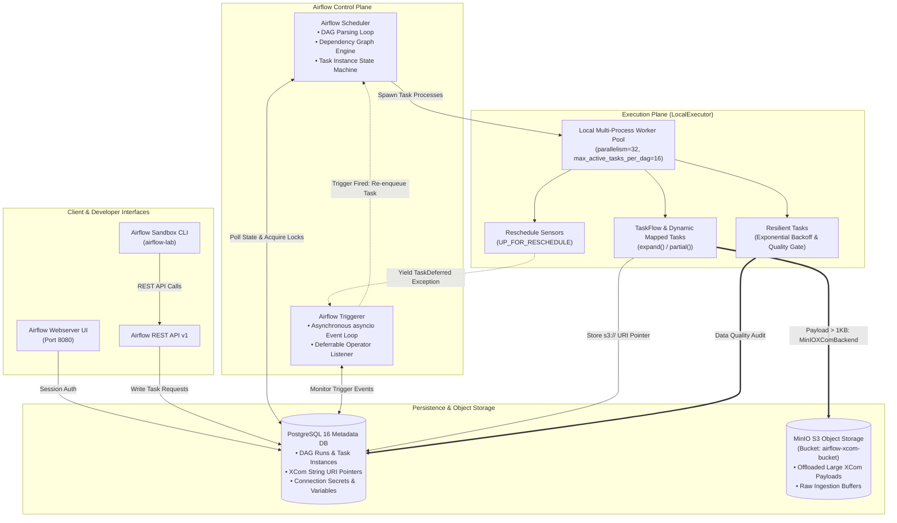
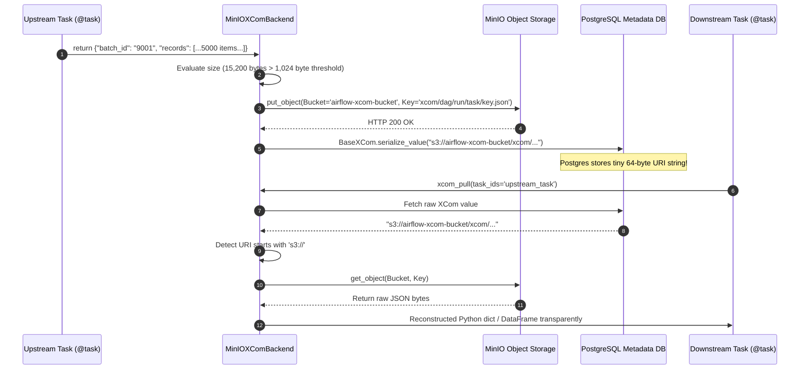

# Apache Airflow 2.10+ Production Sandbox Architecture

[](https://airflow.apache.org/)
[](https://www.postgresql.org/)
[](https://min.io/)
[](https://www.python.org/)

---

## 1. System Architecture & Component Inventory

This repository implements an enterprise-grade Apache Airflow 2.10+ deployment engineered for production reliability, horizontal scalability, and zero-starvation scheduling.



---

## 2. Component Inventory

| Component | Technology | Role & Deployment Responsibility |
| :--- | :--- | :--- |
| **Airflow Scheduler** | Python 3.13 / Airflow 2.10.5 | Parses DAG files, evaluates trigger rules, schedules queued tasks, detects zombie tasks. |
| **Airflow Webserver** | Flask AppBuilder / Gunicorn | Renders workflow DAG graphs, tree views, task logs, and exposes REST API v1. |
| **Airflow Triggerer** | Asyncio Python Daemon | Handles deferrable operators; runs thousands of asynchronous triggers with 0 worker slots. |
| **LocalExecutor** | Multi-Process Worker Pool | Executes task instances as distinct child processes of the scheduler up to `parallelism` limit. |
| **PostgreSQL 16** | Relational Database (ACID) | Metadata store for DAG states, task instance execution records, XCom pointers, and locks. |
| **MinIO S3** | S3-Compatible Object Store | Primary sink for Custom XCom Backend; eliminates Postgres DB bloat for DataFrames and large JSONs. |

---

## 3. Executor Architecture & Tradeoff Matrix

Choosing the correct executor is a pivotal architectural decision for Lead Data Engineers:

| Dimension | `SequentialExecutor` | `LocalExecutor` (This Sandbox) | `CeleryExecutor` | `KubernetesExecutor` |
| :--- | :--- | :--- | :--- | :--- |
| **Concurrency** | 1 (Single-process) | 32+ (Multi-process on single node) | Thousands (Distributed worker cluster) | Tens of thousands (Dynamic Pods) |
| **Infrastructure Overhead** | None (SQLite) | Minimal (Postgres only) | High (Postgres + Redis/RabbitMQ + Flower) | High (Kubernetes cluster + K8s API) |
| **Resource Isolation** | None | Process-level (Shared node RAM/CPU) | Node-level (Dedicated worker nodes) | Container-level (Pod CPU/Memory limits) |
| **Startup Latency** | 0s | ~100ms (Process fork) | ~200ms (Queue consumption) | 5s–30s (Pod scheduling & image pull) |
| **Ideal Production Use Case** | Testing & local debug | Single large VM (up to 64 cores, 256GB RAM) | High-volume homogenous task workflows | Heterogeneous tasks with disparate dependencies & GPU needs |

---

## 4. Custom XCom Architecture (Zero-Bloat S3 Offloading)

Standard Airflow XCom writes all task return values directly into PostgreSQL:
```
PostgreSQL Table: xcom
Columns: (dag_id, task_id, run_id, execution_date, key, value BYTEA)
```
When a task returns a 50MB DataFrame, PostgreSQL writes 50MB into the `xcom` table AND 50MB into Write-Ahead Logs (WAL). At 1,000 runs/day, this introduces **100 GB/day of WAL churn**, bloating database indexes, exhausting disk IOPS, and freezing the Airflow Scheduler during garbage collection (`vacuum`).

### The Solution: `MinIOXComBackend`

